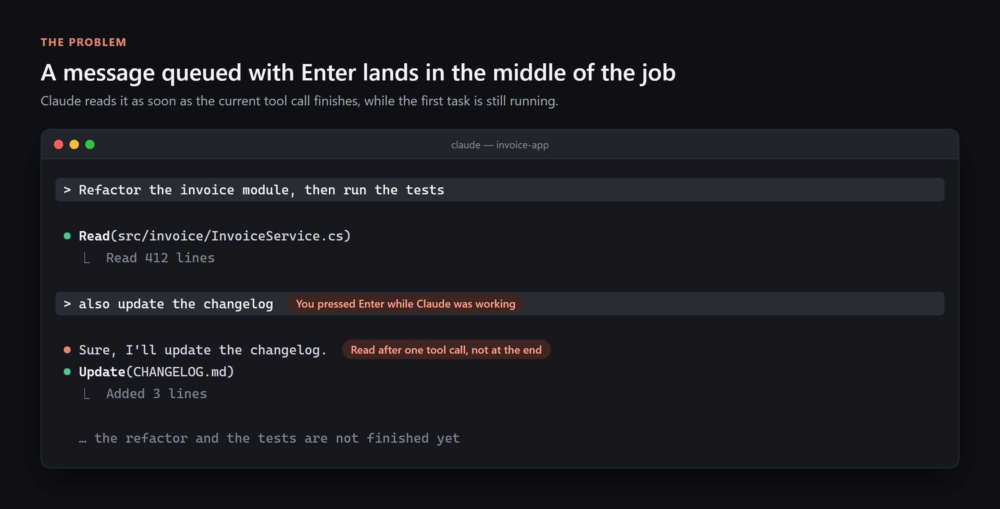
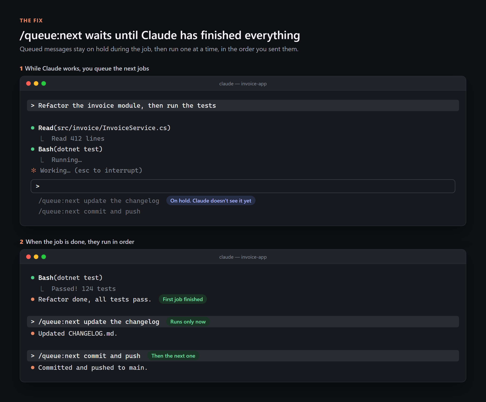
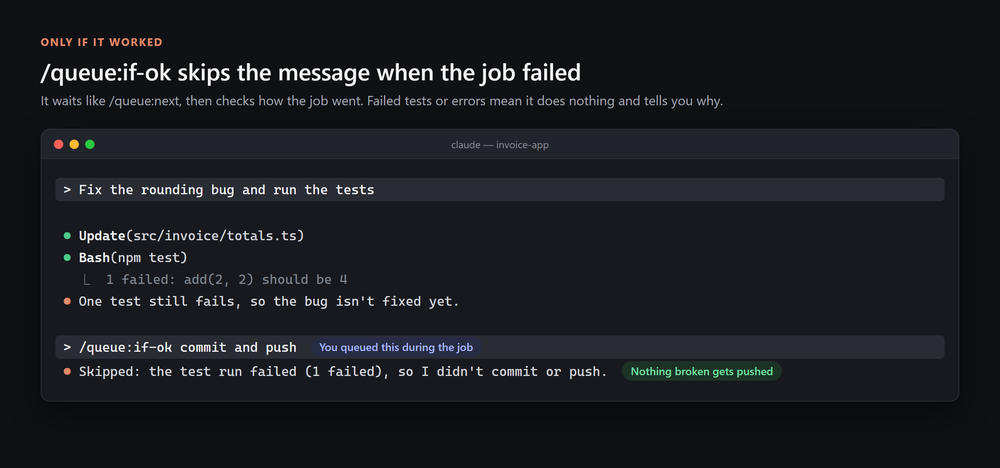
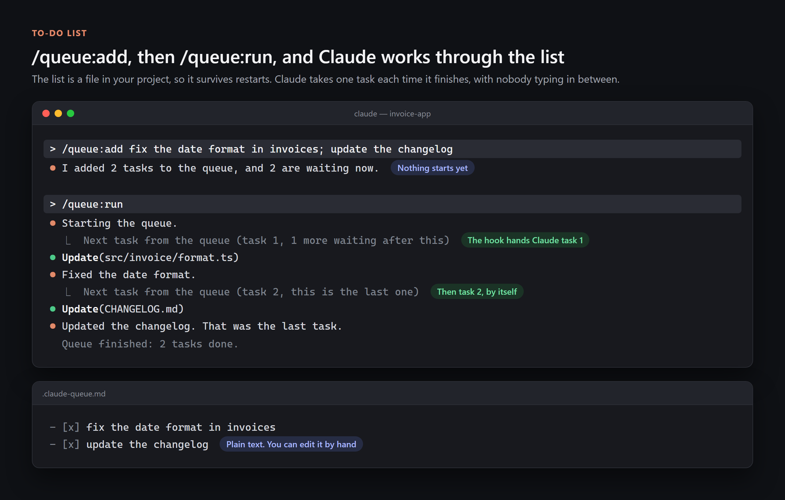

# claude-queue

A Claude Code plugin for lining up work while Claude is busy.

| Command | What it does |
|---|---|
| `/queue:next <message>` | Runs the message after Claude has finished the whole job |
| `/queue:if-ok <message>` | Same, but only if the job succeeded |
| `/queue:add <task>; <task>` | Adds tasks to a to-do list file in your project |
| `/queue:run` | Claude works through the list, one task after another |
| `/queue:list` | Shows the list |
| `/queue:clear` | Empties the list. `/queue:clear done` removes only finished tasks |

## The problem

When you type a message while Claude is working and press Enter, Claude Code queues it. It doesn't wait for the job to end, though. Claude reads it as soon as the current tool call finishes, so a message you meant as "do this afterwards" lands in the middle of the work.



Claude Code has no setting that changes this.

## /queue:next

Claude Code treats queued slash commands differently. It holds them until the turn is over, then runs them one at a time, in the order you sent them. `/queue:next` is a slash command that hands your text to Claude unchanged, so your message gets that later timing.



## /queue:if-ok

`/queue:if-ok` waits the same way. Before doing anything, Claude looks back at the job that just ended. If a test or build failed, a command errored, or the work was left unfinished, it skips your message and says why. Use it for steps that only make sense after a good run, like `/queue:if-ok commit and push`.



It judges by what already happened in the conversation. It doesn't run any new checks.

## To-do list

`/queue:next` keeps messages in Claude Code's input queue, which is gone when you close the app. The to-do list is a file in your project, `.claude-queue.md`, so it stays until you clear it.

```
/queue:add fix the date format in invoices; update the changelog; run the tests
/queue:run
```

`/queue:add` writes the tasks to the file and starts nothing. `/queue:run` starts the list. From then on, each time Claude finishes a task, the plugin's Stop hook gives it the next one, until the list is empty.



The file is plain Markdown, and you can edit it by hand, even while a run is going. The hook reads it again before every task.

```markdown
- [x] fix the date format in invoices
- [>] update the changelog
- [ ] run the tests
```

`[ ]` is waiting, `[>]` is the task Claude is on, `[x]` is done.

Stopping and limits:

- Press Esc to pause. The run doesn't pick up again until you type `/queue:run`, and the task you interrupted goes first.
- A run stops after 20 tasks. Set the environment variable `CLAUDE_QUEUE_MAX_TASKS` to change that.
- A task that fails doesn't stop the run. If a step depends on the one before it, say so in the task, for example "if the tests pass, commit and push".

## Install

Inside Claude Code:

```
/plugin marketplace add zecod/claude-queue
/plugin install queue@zecod
```

The first line adds this repo as a plugin source. You do it once per machine. After that you can also find `queue` by opening `/plugin` and searching the Discover tab.

The same thing from a terminal:

```
claude plugin marketplace add zecod/claude-queue
claude plugin install queue@zecod
```

If the commands don't show up, restart Claude Code. The to-do list needs [Node.js](https://nodejs.org) on your PATH, because its hook is a small Node script. The other commands work without it.

## Which one to use

| You want to | Do this |
|---|---|
| Correct Claude while it works | Type a normal message and press Enter. Claude reads it after the current tool call. |
| Line up the next step for after this job | `/queue:next <message>` |
| Line up a step that needs this job to succeed | `/queue:if-ok <message>` |
| Hand Claude several jobs and walk away | `/queue:add` the tasks, then `/queue:run` |
| Stop Claude now | Press Esc |

To change or drop messages waiting in the input queue, press Up in the empty input box. Claude Code puts them back in the box, where you can edit or clear them.

## How it works

`/queue:next` is one skill file, [`skills/next/SKILL.md`](skills/next/SKILL.md):

```markdown
---
name: next
description: Queue a message that runs only after Claude finishes the whole turn, not after the current tool call.
argument-hint: <message>
disable-model-invocation: true
---
$ARGUMENTS
```

`$ARGUMENTS` becomes whatever you type after `/queue:next`. `disable-model-invocation: true` means only you can run it, and every command in this plugin has it. The timing comes from Claude Code. Its [interactive mode docs](https://code.claude.com/docs/en/interactive-mode.md#when-claude-code-sends-what-you-queued) say queued commands wait until the turn ends, while plain messages go to Claude after the current tool calls.

`/queue:if-ok` is the same idea, with instructions to check the previous job first.

The to-do list uses a [Stop hook](https://code.claude.com/docs/en/hooks.md), [`hooks/queue-stop.mjs`](hooks/queue-stop.mjs), which Claude Code runs every time Claude finishes. `/queue:run` leaves a start file, `.claude-queue.start`. When the hook finds it, it marks the next task `[>]` and tells Claude Code not to stop yet, with that task as the reason. Claude does the task, finishes, and the hook runs again. It marks the task `[x]` and hands out the next one. When nothing is left, the hook lets Claude stop and shows "Queue finished".

The hook only continues a run that it started itself. A turn you start by typing, or a stop forced by another plugin's hook, never pulls a task from the list. On any other turn it exits right away.

The list sits in the project root rather than in `.claude/`, because Claude Code asks for permission before every write inside `.claude/`, even in auto-accept mode. Add `.claude-queue.md` and `.claude-queue.start` to `.gitignore` if you don't want them in git.

## Want plain `/next` instead?

Claude Code always puts the plugin's name in front of a plugin command, so a plugin can't give you a bare `/next`. A personal skill can. Copy the skill file into your user folder.

macOS or Linux:

```sh
mkdir -p ~/.claude/skills/next
curl -fsSL -o ~/.claude/skills/next/SKILL.md https://raw.githubusercontent.com/zecod/claude-queue/main/skills/next/SKILL.md
```

Windows PowerShell:

```powershell
New-Item -ItemType Directory -Force "$HOME\.claude\skills\next" | Out-Null
Invoke-WebRequest https://raw.githubusercontent.com/zecod/claude-queue/main/skills/next/SKILL.md -OutFile "$HOME\.claude\skills\next\SKILL.md"
```

Then use `/next <message>`. If it doesn't show up, restart Claude Code.

## Update or remove

```
claude plugin update queue@zecod
claude plugin uninstall queue@zecod
```

Restart Claude Code after an update.

## Limits

- `/queue:next` and `/queue:if-ok` messages reach Claude as new turns, so they can't steer the job that's already running. Use a plain message for that.
- `/queue:add` sent while Claude is busy is held like any queued command, so it lands after the job. To add tasks during a run, edit `.claude-queue.md` directly.
- `/queue:add` splits tasks on `;`. A task that needs a semicolon in it goes in the file by hand.
- Tested with Claude Code 2.1.318 on Windows 11.

## License

MIT
